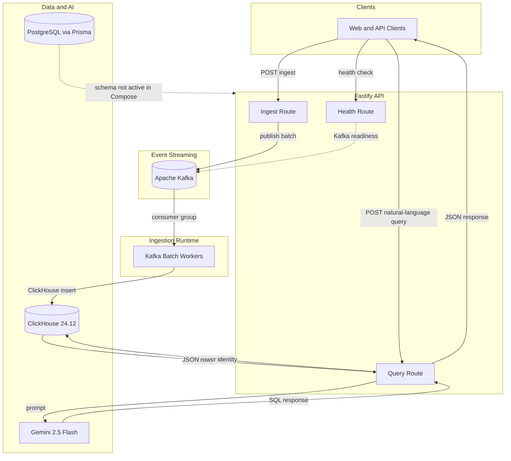
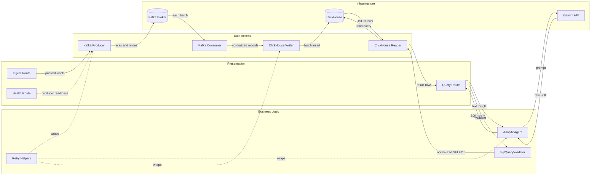

# Architecture Diagram

This architecture reflects the current SentientLog implementation: a Fastify API accepts events and AI questions, Kafka buffers event ingestion, worker instances persist events to ClickHouse, and Gemini generates guarded Text-to-SQL queries.

## Application Architecture

<!-- mermaid-checked: no \n, no em-dash/en-dash, no {} in labels, subgraphs are id["label"], arrows are -->|"label"|, all subgraphs closed by end, ids unique -->

### Technology Stack Summary

| Layer | Technology | Version | Purpose |
|---|---|---|---|
| API | Node.js, Fastify | Node 22, Fastify 5.2.1 | HTTP ingestion, queries, health checks, and route validation |
| Messaging | Apache Kafka | Current Compose image | Durable event handoff with partitioned consumer groups |
| Processing | TypeScript Kafka workers | TypeScript 5.8.2 | Batch normalization and ClickHouse writes |
| Data | ClickHouse | 24.12 | Event storage and analytical SQL execution |
| AI | Google Gemini | gemini-2.5-flash | Converts natural-language questions to ClickHouse SQL |
| Schema tooling | Prisma | 6.19.3 | Defines an optional PostgreSQL data model |
| Packaging | Docker Compose | Docker Compose | Runs API, workers, Kafka, ClickHouse, and migrations |

### Data Storage & External Services

Kafka stores the raw-events stream temporarily and distributes it across the clickhouse-writers-group. ClickHouse is the primary analytical event store, with a dedicated writer identity and a restricted reader identity for AI queries. Gemini is the external AI service used for Text-to-SQL generation. Prisma defines a PostgreSQL model for users, projects, and API keys, but PostgreSQL is not part of the current Compose runtime and that model is not active in the event ingestion or query path.

### Key Architectural Decisions

- Ingestion follows an asynchronous API to Kafka to worker to ClickHouse pipeline, with Kafka acknowledgements and offset commits only after confirmed inserts.
- AI-generated SQL is independently parsed and limited to SELECT access against sentient_log.events before execution through a read-only database identity.
- Docker Compose supports independently scalable worker replicas and persists Kafka and ClickHouse volumes.

## Component Relationships

<!-- mermaid-checked: no \n, no em-dash/en-dash, no {} in labels, subgraphs are id["label"], arrows are -->|"label"|, all subgraphs closed by end, ids unique -->

### Component Inventory

| Component | Layer | Type | Responsibility |
|---|---|---|---|
| Ingest Route | Presentation | Fastify route | Validates event batches, adds IDs and defaults, and publishes events |
| Query Route | Presentation | Fastify route | Sends questions to Gemini, validates SQL, and executes read queries |
| Health Route | Presentation | Fastify route | Reports API health based on shared Kafka producer readiness |
| AnalyticAgent | Business Logic | Service | Builds the ClickHouse schema prompt and calls Gemini |
| SqlQueryValidator | Business Logic | Service | Allows only SELECT statements and sentient_log.events reads |
| Retry Helpers | Business Logic | Utility | Applies bounded retries to Kafka, Gemini, and ClickHouse operations |
| Kafka Producer | Data Access | Messaging client | Sends raw-events records with tenant, service, or URL partition keys |
| Kafka Consumer | Data Access | Messaging client | Reads batches under the clickhouse-writers-group |
| ClickHouse Writer | Data Access | Database client | Inserts normalized event batches with a writer identity |
| ClickHouse Reader | Data Access | Database client | Executes validated AI queries with a restricted reader identity |
| Kafka Broker | Infrastructure | Message broker | Buffers and distributes ingestion events |
| ClickHouse | Infrastructure | Analytical database | Stores and queries event records |
| Gemini API | Infrastructure | External AI API | Generates SQL for natural-language questions |
