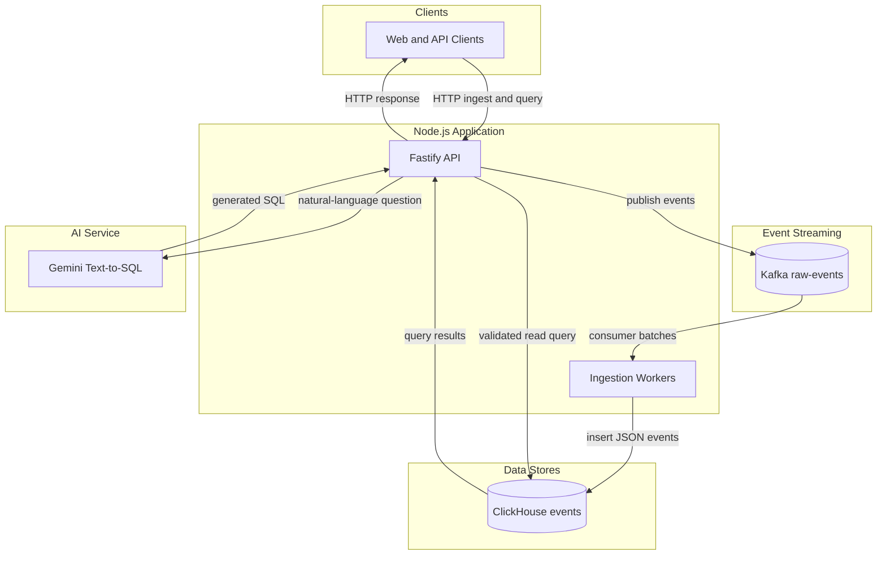

# SentientLog

AI-driven observability platform. Ingests high-frequency website interaction logs into ClickHouse and answers performance questions via Text-to-SQL.

## Architecture

<!-- mermaid-checked: no \n, no em-dash/en-dash, no {} in labels, subgraphs are id["label"], arrows are -->|"label"|, all subgraphs closed by end, ids unique -->


## Quick Start

### 1. Start the stack

```bash
docker compose up -d --scale worker=2
```

This starts one API, Kafka in KRaft mode, ClickHouse, and two ingestion
workers. Kafka creates the `raw-events` topic with **3 partitions**. Workers
share the `clickhouse-writers-group` consumer group, so Kafka distributes
partitions between them. The API is available at `http://localhost:3100`.

To run a different number of workers:

```bash
docker compose up -d --scale worker=4
```

Kafka and ClickHouse are internal Compose services. Their data is persisted in
the `kafka_data` and `ch_data` volumes.

### 2. Configure environment

```bash
cp .env.example .env
# Edit .env — set GEMINI_API_KEY and CLICKHOUSE_AI_PASSWORD
```

### 3. Install & run migration

```bash
npm install
npm run migrate
```

### 4. Start the server locally

```bash
npm run dev
```

The server starts on `http://localhost:3100`. For local API development
against Compose Kafka, set `KAFKA_BROKERS=localhost:9094`; the Compose API and
workers use the internal broker address `kafka:9092`.

### AI-query database guardrails

Set a strong `CLICKHOUSE_AI_PASSWORD` in `.env` before running the migration.
It creates a separate `sentient_ai` user that can only `SELECT` from
`sentient_log.events`. Database-level restrictions prevent AI queries from
changing data, running beyond **10 seconds**, reading more than **5,000,000
rows**, or consuming more than **1 GB** of memory. The query endpoint uses this
identity; ingestion and migrations continue to use `CLICKHOUSE_USER`.

## API

### `POST /api/v1/ingest`

Accepts a batch of log events. Returns `202 Accepted` after Kafka confirms the
events, and the worker fleet writes them to ClickHouse asynchronously.

```json
{
  "events": [
    {
      "event_type": "page_view",
      "url": "/dashboard",
      "latency_ms": 142.5,
      "metadata": { "referrer": "google.com" }
    }
  ]
}
```

### `POST /api/v1/query`

Accepts a natural-language question about your logs. The AnalyticAgent converts it to ClickHouse SQL, executes it, and returns the results.

```json
{ "question": "What is the p99 latency for page views in the last hour?" }
```

### `GET /health`

Returns `{ "status": "ok" }` when the API can reach Kafka.

## Project Structure

```
src/
├── api/            Routes and controllers
│   └── routes/
│       ├── ingest.ts   Batch ingestion endpoint
│       └── query.ts    AI-powered query endpoint
├── db/             ClickHouse client and migrations
│   ├── client.ts
│   └── migrations/
├── messaging/      Kafka producer and consumer configuration
│   └── kafka.ts
├── services/       Core logic
│   ├── AnalyticAgent.ts       Text-to-SQL via Gemini
│   ├── SqlQueryValidator.ts   AI SQL safety validation
│   └── retry.ts               Retry and transient-error handling
├── workers/        ClickHouse ingestion worker
│   └── ingestWorker.ts
└── types/          TypeScript interfaces
    └── log.ts
```
